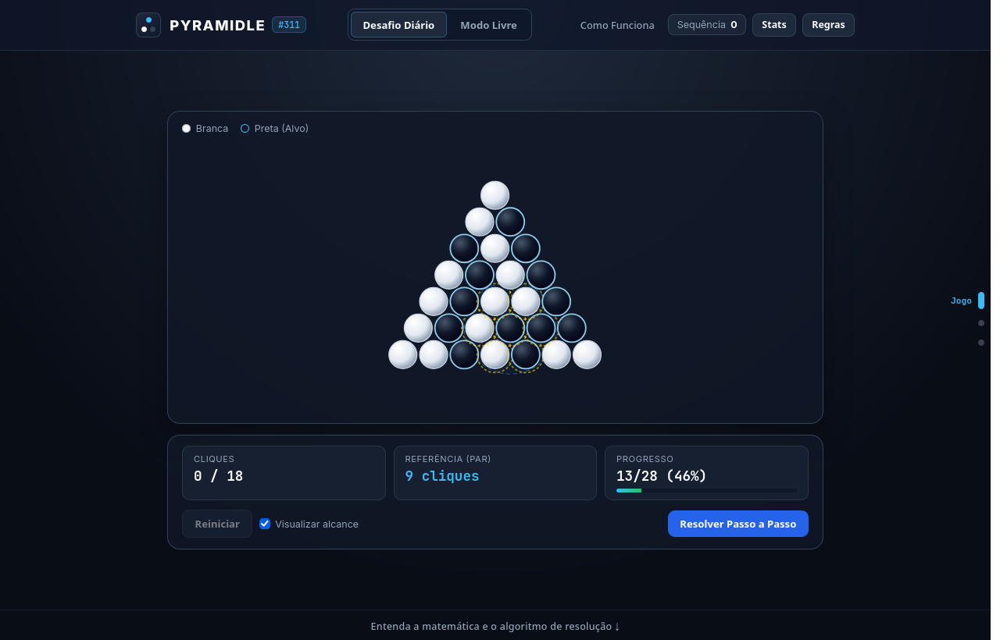
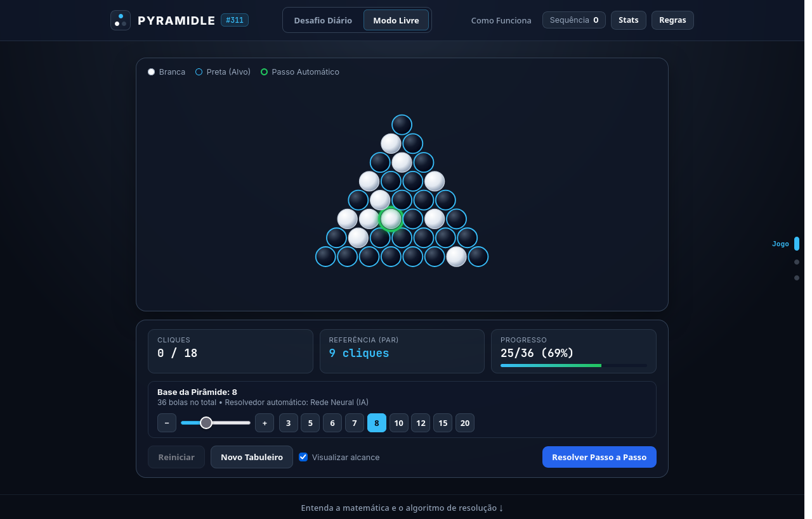
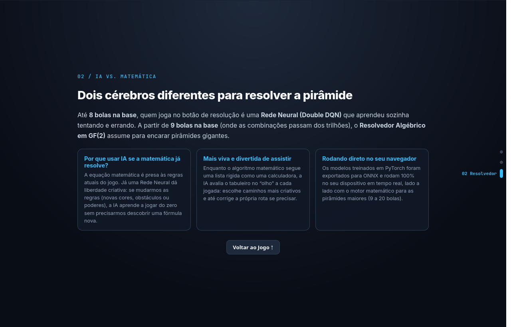

# Balls Pyramid — Deep Reinforcement Learning & $\mathbb{GF}(2)$ Solver


Um jogo de quebra-cabeça interativo em grade triangular (inspirado no clássico *Lights Out*) desenvolvido em **Python + Pygame** e **React**, equipado com um agente autônomo de **Aprendizado por Reforço Profundo (Double Deep Q-Network)** em **PyTorch** e um validador algébrico baseado em **Eliminação Gaussiana no Corpo Finito $\mathbb{GF}(2)$**.

---

## O Problema e o Desafio de IA

O jogo consiste em uma pirâmide de base $n$ contendo $N = \frac{n(n+1)}{2}$ bolas (brancas ou pretas).
- **Regra de transição**: Clicar em uma bola inverte a cor dela própria e de todas as bolas vizinhas dentro de um raio geométrico de $3r$.
- **Objetivo**: Tornar **todas as bolas pretas** com o menor número de cliques possível.

### Por que o Q-Learning tradicional (Q-Table) falha neste problema?
Em uma abordagem tabular clássica, cada configuração da pirâmide é armazenada como uma chave isolada em um dicionário. Isso esbarra em três barreiras matemáticas:

1. **Explosão Combinatória ($2^N$ estados)**:
   | Base da Pirâmide ($n$) | Total de Bolas ($N$) | Espaço de Estados ($2^N$) | Viabilidade de Q-Table |
   | :---: | :---: | :---: | :---: |
   | $3$ | $6$ | $64$ | Viável |
   | $5$ | $15$ | $32.768$ | Lento |
   | $6$ | $21$ | $2.097.152$ | Inviável |
   | $8$ | $36$ | $68.719.476.736$ | Impossível em RAM |

2. **Ausência de Generalização Espacial**: Uma Q-Table não compartilha conhecimento entre estados parecidos (ex.: mudar 1 única bola cria uma chave desconhecida).
3. **Configurações Matematicamente Insolúveis**: Sorteios puramente aleatórios podem gerar estados que não pertencem ao espaço coluna da matriz de adjacência do grafo, prendendo agentes ingênuos em loops infinitos.

---

## Galeria

| Desafio Diário & Alcance $3r$ | Modo Livre (Base 2–20) & Resolução Guiada |
| :---: | :---: |
|  |  |
| **Slides Interativos (IA vs. Matemática)** | **Limite de Cliques ($2\times$ Par) & Fim de Jogo** |
|  |  |

---

## Arquitetura da Solução

Para superar as limitações tabulares, o projeto combina **Álgebra Linear sobre $\mathbb{GF}(2)$** com **Deep Reinforcement Learning (Double DQN)**:

### 1. Detector e Resolvedor via Álgebra Linear em $\mathbb{GF}(2)$
Como a ordem dos cliques é comutativa e clicar duas vezes na mesma bola anula a operação ($1 \oplus 1 = 0$), o jogo pode ser modelado como um sistema linear binário:

$$A \cdot x \equiv b \pmod 2$$

- $A \in \{0, 1\}^{N \times N}$: Matriz de adjacência pré-calculada onde $A_{i,j} = 1 \iff \text{dist}(i, j) \le 3r$.
- $b \in \{0, 1\}^N$: Vetor indicando quais bolas estão brancas no estado atual ($b_i = 1 \oplus s_i$).
- A matriz aumentada $[A \mid I]$ é escalonada a priori via **Eliminação de Gauss-Jordan com `XOR` (`^`)**, gerando a matriz de transformação $R$. Isso garante em tempo $O(N^2)$ que nenhum episódio comece insolúvel (`is_solvable()`), fornece a distância exata de cliques restantes (`clicks_remaining()`) e atua como resolvedor passo a passo para pirâmides gigantes ($n = 9 \dots 20$).

### 2. Deep Q-Network (Double DQN) + Curriculum Learning
- **Arquitetura da Rede (`QNetwork`)**: Multilayer Perceptron (`Linear(N, 128) → ReLU → Linear(128, 128) → ReLU → Linear(128, N)`) que recebe o vetor binário do tabuleiro e estima simultaneamente o valor $Q(s, a)$ de clicar em cada bola.
- **Double DQN & Experience Replay**: Utiliza um `ReplayBuffer` de $200.000$ transições e duas redes (*Policy Network* e *Target Network*) com **Huber Loss (`SmoothL1Loss`)** e **Gradient Clipping** para evitar superestimação e *Catastrophic Forgetting*:
  $$y = r + \gamma (1 - \text{done}) \, Q_{\text{target}}\!\left(s', \arg\max_{a'} Q_{\text{policy}}(s', a')\right)$$
- **Reward Shaping Algébrico**: Recompensa guiada pela redução da distância algébrica em $\mathbb{GF}(2)$ (`clicks_remaining`) somada ao bônus terminal de $+100$ ao solucionar a pirâmide.
- **Curriculum Learning & Best Checkpoint**: O treinamento inicia com tabuleiros a 1 clique da solução e escala progressivamente até o embaralhamento completo, salvando automaticamente o checkpoint de maior taxa de vitória na dificuldade máxima.
- **Inferência no Navegador via ONNX Runtime Web**: Os modelos treinados em PyTorch são exportados para `.onnx` (`export_weights.py`) e executados diretamente no navegador via WebAssembly (`onnxruntime-web`).

---

## Curvas de Aprendizado e Convergência

O gráfico abaixo é gerado automaticamente ao final de `train.py` e demonstra a evolução da **Taxa de Vitória (Win Rate %)**, **Recompensa Acumulada** e redução da **Loss** durante o treinamento:


---

## Como Executar o Projeto

### 1. Clonar o repositório e instalar dependências
```bash
git clone https://github.com/FeLiPeOLi7/effective-train
cd effective-train/BallsPyramid
pip install -r requirements.txt
```

### 2. Executar o Jogo com a IA (`ballsAI.py`)
```bash
python3 ballsAI.py
```
- Escolha o número de bolas na base da pirâmide:
  - **De `1` até `8` bolas na base**: Resolução passo a passo via **Rede Neural (Double DQN)**.
  - **Acima de `8` bolas na base (`9` a `20`)**: Resolução passo a passo via **Solver Algébrico em $\mathbb{GF}(2)$**.

### 3. Re-treinar os Modelos e Gerar os Gráficos (`train.py`)
```bash
python3 train.py
```
- Treina os modelos especialistas de base `1` a `8`, salva os pesos em `dqn_model.pth` e exporta o gráfico atualizado em `assets/learning_curves.png`.

### 4. Executar a Versão Web — PYRAMIDLE (React + Vite + ONNX Runtime Web)
O projeto inclui uma aplicação Web completa em [`web/`](web/) com **Desafio Diário** (alternando entre bases 5, 6, 7 e 8) e **Modo Livre** (bases de 2 até 20 bolas), executando a Rede Neural diretamente no navegador via **ONNX Runtime Web**:

```bash
# Exportar os modelos de dqn_model.pth para arquivos .onnx em web/public/
python3 export_weights.py

# Iniciar o servidor web em modo de desenvolvimento
cd web
npm install
npm run dev
```

---

## Estrutura de Arquivos

| Arquivo / Pasta | Descrição |
| :--- | :--- |
| [`ballsAI.py`](ballsAI.py) | Ambiente do jogo em Pygame, matriz de adjacência pré-escalonada em $\mathbb{GF}(2)$, `QNetwork` e modo `Solve` passo a passo. |
| [`train.py`](train.py) | Agente Double DQN (Huber Loss + Gradient Clipping), `ReplayBuffer`, *Curriculum Learning* e geração de `assets/learning_curves.png`. |
| [`export_weights.py`](export_weights.py) | Exporta os modelos PyTorch (`dqn_model.pth`) para formato `.onnx` (`web/public/model_1.onnx` ... `model_8.onnx`). |
| [`web/`](web/) | Aplicação Web React (**PYRAMIDLE**): Desafio Diário, estatísticas/Streak, limite de cliques ($2\times$ Par) e inferência via ONNX Runtime Web + $\mathbb{GF}(2)$. |
| [`balls.py`](balls.py) | Versão original minimalista do jogo (apenas para jogador humano). |
| `dqn_model.pth` | Checkpoint PyTorch contendo os pesos treinados das redes neurais (`n = 1..8`). |
| `assets/` | Curvas de convergência do treinamento (`learning_curves.png`) e capturas da interface web. |
