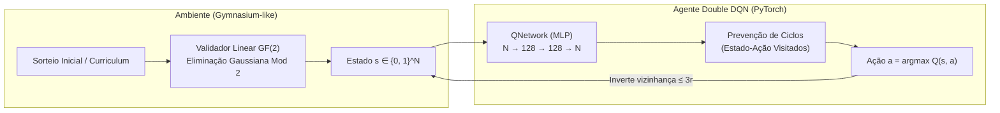
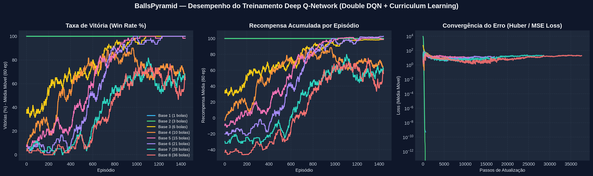

# 🎱 Balls Pyramid — Deep Reinforcement Learning & $\mathbb{GF}(2)$ Solver


Um jogo de quebra-cabeça interativo em grade triangular (inspirado no clássico *Lights Out*) desenvolvido em **Python + Pygame**, equipado com um agente autônomo de **Aprendizado por Reforço Profundo (Double Deep Q-Network)** em **PyTorch** e um validador algébrico baseado em **Eliminação Gaussiana no Corpo Finito $\mathbb{GF}(2)$**.

---

## 🎯 O Problema e o Desafio de IA

O jogo consiste em uma pirâmide de base $n$ contendo $N = \frac{n(n+1)}{2}$ bolas (brancas ou pretas).
- **Regra de transição**: Clicar em uma bola inverte a cor dela própria e de todas as bolas vizinhas dentro de um raio geométrico de $3r$.
- **Objetivo**: Tornar **todas as bolas pretas** com o menor número de cliques possível.

### Por que o Q-Learning tradicional (Q-Table) falha neste problema?
Em uma abordagem tabular clássica, cada configuração da pirâmide é armazenada como uma chave isolada em um dicionário. Isso esbarra em três barreiras matemáticas:

1. **Explosão Combinatória ($2^N$ estados)**:
   | Base da Pirâmide ($n$) | Total de Bolas ($N$) | Espaço de Estados ($2^N$) | Viabilidade de Q-Table |
   | :---: | :---: | :---: | :---: |
   | $3$ | $6$ | $64$ | ✅ Viável |
   | $5$ | $15$ | $32.768$ | ⚠️ Lento |
   | $6$ | $21$ | $2.097.152$ | ❌ Inviável |
   | $8$ | $36$ | $68.719.476.736$ | ❌ Impossível em RAM |

2. **Ausência de Generalização Espacial**: Uma Q-Table não compartilha conhecimento entre estados parecidos (ex.: mudar 1 única bola cria uma chave desconhecida).
3. **Configurações Matematicamente Insolúveis**: Sorteios puramente aleatórios podem gerar estados que não pertencem ao espaço coluna da matriz de adjacência do grafo, prendendo agentes ingênuos em loops infinitos.

---

## 🧠 Arquitetura da Solução

Para superar as limitações tabulares, o projeto combina **Álgebra Linear sobre $\mathbb{GF}(2)$** com **Deep Reinforcement Learning (Double DQN)**:



### 1. Detector de Solucionabilidade via Álgebra Linear em $\mathbb{GF}(2)$
Como a ordem dos cliques é comutativa e clicar duas vezes na mesma bola anula a operação ($1 \oplus 1 = 0$), o jogo pode ser modelado como um sistema linear binário:

$$A \cdot x \equiv b \pmod 2$$

- $A \in \{0, 1\}^{N \times N}$: Matriz de adjacência pré-calculada onde $A_{i,j} = 1 \iff \text{dist}(i, j) \le 3r$.
- $b \in \{0, 1\}^N$: Vetor indicando quais bolas estão brancas no estado atual ($b_i = 1 \oplus s_i$).
- A função `is_solvable()` aplica **Eliminação Gaussiana com `XOR` (`^`)** na matriz aumentada $[A \mid b]$ para garantir que nenhum episódio de treino ou partida humana comece em um estado matematicamente impossível.

### 2. Deep Q-Network (Double DQN) + Curriculum Learning
- **Arquitetura da Rede (`QNetwork`)**: Multilayer Perceptron (`Linear(N, 128) → ReLU → Linear(128, 128) → ReLU → Linear(128, N)`) que recebe o vetor binário do tabuleiro e estima simultaneamente o valor $Q(s, a)$ de clicar em cada bola.
- **Double DQN & Experience Replay**: Utiliza um `ReplayBuffer` circular de $15.000$ transições e duas redes (*Policy Network* e *Target Network*) para evitar superestimação dos valores $Q$:
  $$y = r + \gamma (1 - \text{done}) \, Q_{\text{target}}\!\left(s', \arg\max_{a'} Q_{\text{policy}}(s', a')\right)$$
- **Reward Shaping**: Recompensa densa baseada no saldo de bolas convertidas no passo ($\Delta \text{pretas} - 0.5$) somada ao bônus terminal de $+100$ ao solucionar a pirâmide.
- **Curriculum Learning**: O treinamento inicia com tabuleiros embaralhados a poucos cliques da solução e aumenta progressivamente a entropia até sorteios 100% aleatórios, permitindo convergir em pirâmides maiores ($n = 5 \dots 8$).
- **Prevenção Inteligente de Ciclos**: Impede cliques duplos imediatamente consecutivos e evita repetir a mesma ação caso o tabuleiro retorne a uma fotografia de estado idêntica já visitada, mantendo total liberdade para o humano (e para a IA) clicarem na mesma bola ao longo da partida para corrigir erros.

---

## 📈 Curvas de Aprendizado e Convergência

O gráfico abaixo é gerado automaticamente ao final de `train.py` e demonstra a evolução da **Taxa de Vitória (Win Rate %)**, **Recompensa Acumulada** e redução da **Loss** durante o treinamento:



---

## 🚀 Como Executar o Projeto

### 1. Clonar o repositório e instalar dependências
```bash
git clone https://github.com/FeLiPeOLi7/effective-train
cd effective-train/BallsPyramid
pip install -r requirements.txt
```

### 2. Executar o Jogo com a IA (`ballsAI.py`)
```bash
python3 ballsAI.py
```
- Escolha o número de bolas na base da pirâmide:
  - **De `1` até `8` bolas na base**: Você pode jogar manualmente clicando nas bolas ou clicar no botão azul **Solve** para assistir à Rede Neural resolvendo passo a passo (com destaque visual em verde a cada clique).
  - **Acima de `8` bolas na base**: Modo **Desafio Humano** (o botão *Solve* é ocultado e a resolução fica 100% a cargo do jogador).

### 3. Re-treinar os Modelos e Gerar os Gráficos (`train.py`)
```bash
python3 train.py
```
- Treina os modelos especialistas de base `1` a `8`, salva os pesos em `dqn_model.pth` e exporta o gráfico atualizado em `assets/learning_curves.png`.

---

## 📂 Estrutura de Arquivos

| Arquivo | Descrição |
| :--- | :--- |
| [`ballsAI.py`](ballsAI.py) | Ambiente do jogo em Pygame, matriz de adjacência, detector $\mathbb{GF}(2)$ (`is_solvable`), `QNetwork` e modo `Solve` passo a passo. |
| [`train.py`](train.py) | Agente Double DQN, `ReplayBuffer`, *Curriculum Learning*, loop de treinamento multi-tamanho e geração dos gráficos em `assets/learning_curves.png`. |
| [`balls.py`](balls.py) | Versão original minimalista do jogo (apenas para jogador humano). |
| `dqn_model.pth` | Checkpoint PyTorch contendo os pesos treinados das redes neurais (`n = 1..8`). |
| `assets/learning_curves.png` | Painel com as métricas de convergência do treinamento. |
